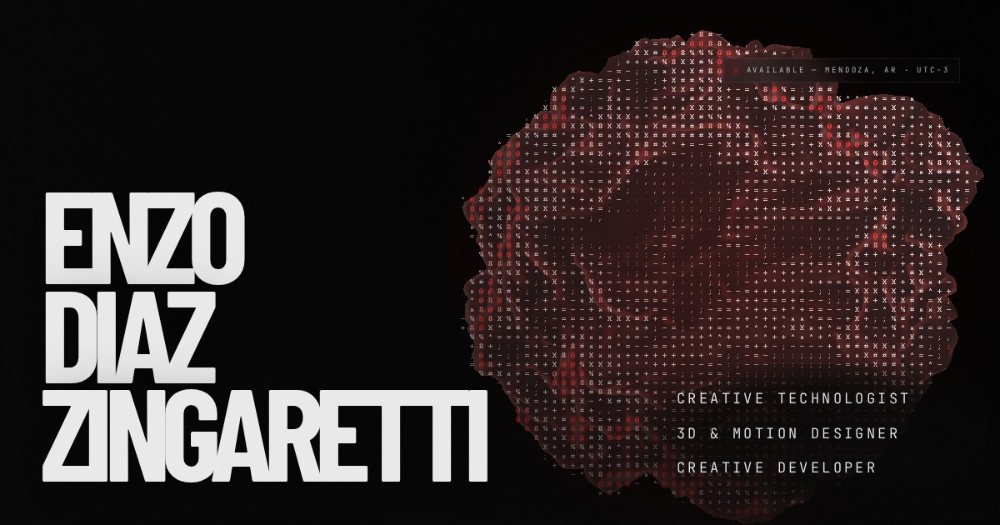

# Enzo Diaz Zingaretti — Portfolio



Portfolio of a motion & 3D designer: campaigns, motion and 3D for brands and artists, and the real-time and web work behind them. React + Three.js, deployed on Vercel, in Spanish, English and Portuguese.

**Live:** [enzo-diaz-zingaretti.vercel.app](https://enzo-diaz-zingaretti.vercel.app)

<!-- Pendiente: un GIF de 8 s del hero acá arriba se ve mejor que la captura. -->

## What to look at

| If you care about… | Start here |
|---|---|
| **How the work was done** | Five case studies on the live site: [the Sonar Produce campaign](https://enzo-diaz-zingaretti.vercel.app/grafica/sonar-produce) (identity, campaign and motion for an event producer's first night), [this portfolio](https://enzo-diaz-zingaretti.vercel.app/tech/portfolio), [Andino Seguros](https://enzo-diaz-zingaretti.vercel.app/tech/andino-seguros) (Next.js, Supabase and a custom panel for an insurance broker), [Tamara González](https://enzo-diaz-zingaretti.vercel.app/tech/tamara-gonzalez) and [five artist press kits](https://enzo-diaz-zingaretti.vercel.app/tech/press-kits). The brief, the decisions and what was ruled out, and what testing turned up. Source in [`src/cases/`](src/cases). |
| **Real-time graphics** | [`HeroGlass.jsx`](src/components/HeroGlass.jsx): one WebGL context for the whole site. Three.js scenes rewritten as characters in the background (a two-pass ASCII filter: per-cell averages, then glyphs, with black and white points measured per scene), a legibility mask that dims them behind text, and a glass sculpture with a hand-written refraction shader over the name. The scenes are in [`asciiScenes.js`](src/fx/asciiScenes.js), including a 16,000-particle swarm moved entirely in the vertex shader. |
| **Generative systems** | [`src/lab/pieces/`](src/lab/pieces): eight canvas pieces, each a different algorithm family (Gray-Scott reaction-diffusion, De Jong attractor, Chladni figures, Verlet cloth, harmonograph…), with live parameters and seeded randomness: same seed, same artwork. |
| **Product engineering** | [`api/`](api): a git-backed admin. Serverless functions commit content to this repository through the GitHub API and Vercel redeploys. scrypt password hash, HMAC-signed session cookies, a write allowlist. No database. |
| **Performance** | the WebGL background runs at 30 fps outside the hero and stops behind overlays and in hidden tabs; the preloader runs once per session; grid covers are 8-second, ~600 KB cuts instead of the full videos; images are capped at 1600 px; hashed assets are cached as immutable. |
| **Testing** | [`tests/`](tests): content integrity across the three languages, the case studies (same structure in every language, images that exist and measure what they declare), the admin's auth and path checks, category building. CI runs lint, tests and a production build on every push. |

## Stack

React 19 · Vite 6 · React Router 7 · Tailwind CSS 3 · Three.js · Lenis · Vercel Functions (Node) · Vitest

## Architecture notes

- **Four routes, one per discipline** (`/motion`, `/3d`, `/grafica`, `/tech`) inside a persistent shell, plus case study pages under their category (`/tech/<slug>`, `/grafica/sonar-produce`) that load their text only when opened. The WebGL background lives in the shell and runs on every route without recreating the context.
- **Content has two sources.** [`src/siteContent.i18n.js`](src/siteContent.i18n.js) holds every string in the three languages. [`public/content.json`](public/content.json) is what the admin edits, and it overrides the Spanish copy at runtime. [`tests/content.test.js`](tests/content.test.js) fails if the two drift apart, or if a piece points at a file that is not in `public/`.
- **The initial language comes from the browser**, falling back to English.
- **Overlays and smooth scroll:** Lenis cancels wheel and touch events while an overlay is open, so every scrollable container inside one carries `data-lenis-prevent`.

## Running locally

```bash
npm install
npm run dev      # http://localhost:5173
npm test         # vitest
npm run build
```

Admin setup (environment variables, password hash): [`ADMIN_SETUP.md`](ADMIN_SETUP.md).

`CLAUDE.md` is the engineering log, in Spanish: decisions, measurements and traps that were already solved.

---

<details>
<summary><b>Español</b></summary>

<br>

Portfolio de un motion & 3D designer: campañas, motion y 3D para marcas y artistas, y el trabajo en tiempo real y web que hay detrás. React + Three.js, en Vercel, en español, inglés y portugués.

**Qué mirar:**

- **Gráficos en tiempo real:** `src/components/HeroGlass.jsx`, un solo contexto WebGL para todo el sitio: escenas de Three.js reescritas como caracteres en el fondo (un filtro ASCII en dos pasos), una máscara que las apaga detrás del texto y una escultura de vidrio con un shader de refracción propio sobre el nombre. Las escenas, con un enjambre de 16.000 partículas movido entero en el vertex shader, en `src/fx/asciiScenes.js`.
- **Sistemas generativos:** `src/lab/pieces/`, ocho piezas en canvas, cada una de una familia de algoritmo distinta, con parámetros en vivo y azar con semilla.
- **Producto:** `api/`, un panel de administración sobre git: las funciones serverless commitean el contenido en este repo por la API de GitHub. Hash scrypt, cookies de sesión firmadas con HMAC, lista blanca de escritura, sin base de datos.
- **Casos de estudio:** `/grafica/sonar-produce`, `/tech/portfolio`, `/tech/andino-seguros`, `/tech/tamara-gonzalez` y `/tech/press-kits` en el sitio: el pedido, las decisiones y lo descartado, y lo que apareció probando. El texto vive en `src/cases/`.
- **Tests:** `tests/`, integridad del contenido en los tres idiomas, la autenticación del panel y la construcción de categorías. El CI corre lint, tests y build en cada push.

**Contenido:** los textos viven en `src/siteContent.i18n.js` (tres idiomas) y `public/content.json`, que edita el panel y pisa el español. Un test falla si se desincronizan.

```bash
npm install && npm run dev
```

</details>
